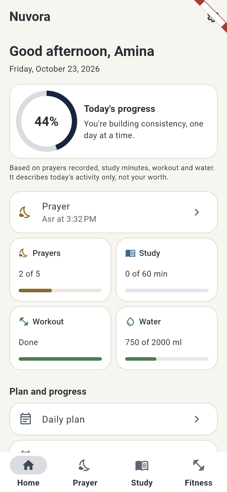
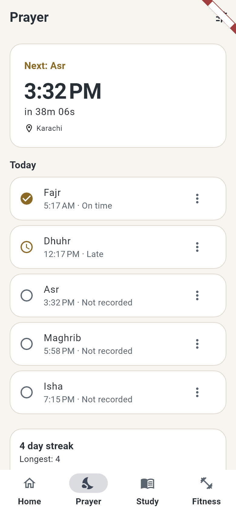
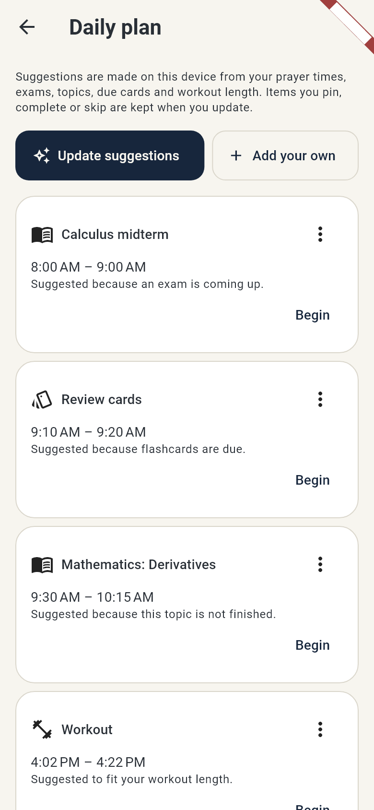
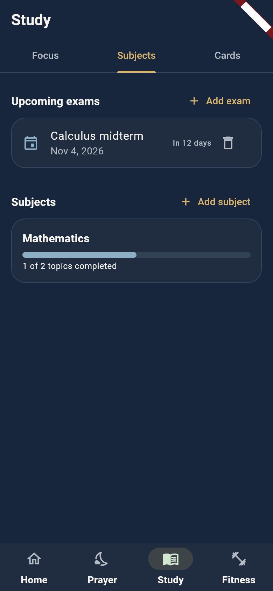

# Nuvora

**Strengthen Your Body, Elevate Your Soul, Expand Your Mind.**

Nuvora is an offline-first Flutter app (Android first) for building a balanced
daily routine across three areas of life, in one calm, consistent interface:

| | Area | What you can do |
| --- | --- | --- |
| 🌿 | **Body** | guided no-equipment workouts, water tracking, fasting timer |
| 🌙 | **Soul** | calculated prayer times, prayer tracking and streaks |
| 📘 | **Mind** | focus timer, subjects and syllabus, exams, spaced-repetition flashcards |

Around those sit a **daily planner**, a **habit calendar**, a private
**journal**, **progress** (milestones, XP, weekly report), local **reminders**,
**backup and restore**, and two clearly optional layers: **cloud sync** and an
**AI assistant**. Everything core works with no internet and no account.

<p>
  
  
  
  
</p>

*Screenshots are rendered from the real widgets with sample data (see
`tool/screenshots_test.dart`), not captured from a phone.*

## Features

**Home**: greeting and date, a daily progress ring built from your real data
(prayers, study minutes, workout, water), next prayer, one-tap +250 ml water,
quick actions. The score is transparent and says it is not a measure of worth.

**Prayer**: times calculated on the device with a maintained library
(`adhan_dart`), several calculation methods, standard or Hanafi Asr, city list
or manual coordinates (no location permission needed), a live countdown to the
next prayer, a five-prayer checklist (on time, late, missed, or not recorded),
streaks and a 7-day summary. A prayer you have not recorded is never counted
as missed.

**Study**: Pomodoro-style focus and break timer that survives the app being
closed (it stores timestamps, not a running countdown), subjects with
prioritised topics and progress, exam countdowns, and flashcards with a
documented spaced-repetition algorithm and full review history.

**Fitness**: six original beginner workouts (full body, upper, lower, core,
mobility, a short one) with a step-by-step player, work and rest timers, skip
and previous, easier options, and history; water tracking with an adjustable
goal; a fasting timer with a safety note.

**Plan and progress**: an offline rule-based daily planner (prayer times, exams,
topics, due cards, workout; no overlaps; your edits are kept), a habit
calendar that separates *complete*, *partial*, *missed* and *nothing recorded*,
a private daily reflection journal with search, milestone badges, XP and a
weekly report.

**Reminders**: independent, off-by-default reminders for prayer times, study,
workout, water, reflection, flashcards and a weekly summary; quiet hours;
generic notification text by default; permission requested only after an
explanation.

**Your data**: multiple isolated local profiles, a versioned JSON backup
(secrets excluded) with safe restore, light/dark/system themes, English and
Urdu strings.

**Optional cloud sync** (your own Supabase project): per-category opt-in
(journal and prayer data are private by default), last-writer-wins with
documented rules, deletions that propagate, safe retries.

**Optional AI assistant**: off until you turn it on; you choose which summaries
it may see; your journal and name are never sent; replies are labelled
"AI-generated", shown as drafts you review before saving, and a local offline
suggestion is always available.

## Status: what is verified and what is not

Be aware of the difference between *tested here* and *proven in the field*:

- **Tested with automated tests** (unit, database and widget tests on an
  in-memory database): all core tracking, the algorithms, backup/restore,
  migrations, the sync engine (simulating two devices), the reminder planner and
  service, and the AI consent and data-minimisation rules.
- **Tested only against fakes or mocked HTTP**: cloud sign-in, the Supabase
  remote, the AI client, and notification scheduling. **The Supabase SQL,
  row-level-security policies and both server functions have not been deployed
  or run against a live project**, and **no AI provider has been called**.
  Use the checklist in [docs/BACKEND.md](docs/BACKEND.md) before trusting them.
- **Not observed on a physical phone**: notification delivery, the permission
  prompt, sharing a backup file, picking a file to restore, and installing the
  APK. A debug APK builds successfully.

**Not built yet** (from the original plan): Qibla compass, Quran reading
tracker, dhikr/tasbih counter, workout set/rep/weight logging, body
measurements, linking topics to exams, local app lock, a screen to set the
local recovery question, dashboard card customisation and editable score
weights, monthly challenges, streak recovery, fasting reminders, an automatic
location option, push notifications, iOS, and on-device integration tests.

## Quick start

Requirements: Windows 10/11, Git, Flutter 3.47.7 (stable) with Dart 3.13.5,
Android Studio with the Android SDK.

```powershell
git clone https://github.com/muhammadyaseen2k03/nuvora.git
cd nuvora
flutter pub get
flutter run                  # an emulator or a USB-connected phone
```

Generated code (`lib/data/database.g.dart`, `lib/l10n/gen/`) is in the repo. If
you change a database table or a string, regenerate it:

```powershell
dart run build_runner build
flutter gen-l10n
```

### Full Windows setup

1. Install [Git](https://git-scm.com/download/win).
2. Install Flutter: <https://docs.flutter.dev/get-started/install/windows/mobile>
   (or `git clone https://github.com/flutter/flutter.git -b stable C:\src\flutter`
   and add `C:\src\flutter\bin` to `PATH`).
3. Install [Android Studio](https://developer.android.com/studio) and, in
   *Settings > Languages & Frameworks > Android SDK*, the SDK Platform and
   Command-line Tools.
4. Point Flutter at them and accept licences:
   ```powershell
   flutter config --android-sdk "$env:LOCALAPPDATA\Android\Sdk"
   flutter config --jdk-dir "C:\Program Files\Android\Android Studio\jbr"
   flutter doctor --android-licenses
   flutter doctor
   ```
5. Emulator: Android Studio *Device Manager*, create and start a device.
   Phone: enable *Developer options* and *USB debugging*, connect, and run
   `flutter devices`.

The first Android build downloads a lot (Gradle, plugins) and can take 10-20
minutes on a slow connection. Later builds are much faster. If a build fails
with a download timeout, run it again; it resumes from what was cached.

## Check and build

```powershell
flutter analyze                       # expected: No issues found
flutter test                          # runs the automated tests
flutter build apk --debug             # build\app\outputs\flutter-apk\app-debug.apk
flutter build apk --release
adb install -r build\app\outputs\flutter-apk\app-debug.apk
```

> **Release signing.** The release build is currently signed with the *debug*
> key (see `android/app/build.gradle.kts`). That is fine for testing but not for
> distribution. Create a keystore and configure `signingConfigs.release`
> (<https://docs.flutter.dev/deployment/android#sign-the-app>) before publishing,
> and keep the keystore and `key.properties` out of version control (they are
> git-ignored).

## Optional: cloud sync and AI

Both are **off** unless you build with your own Supabase project's URL and
**anon (public)** key. Without them the cloud and AI features say they are not
set up and everything else works.

1. Create a project at <https://supabase.com>; enable Email auth and keep
   email confirmation on.
2. `supabase link --project-ref <ref>` then `supabase db push` (applies
   `backend/supabase/migrations/`).
3. Deploy the functions and set secrets **on the server only**:
   ```powershell
   supabase functions deploy delete-account
   supabase functions deploy ai
   supabase secrets set AI_PROVIDER_API_KEY=... AI_MODEL=... AI_DAILY_LIMIT=30
   ```
4. Copy `.env.example` to `.env`, fill in `SUPABASE_URL` and `SUPABASE_ANON_KEY`,
   then:
   ```powershell
   flutter run --dart-define-from-file=.env
   flutter build apk --release --dart-define-from-file=.env
   ```

Never put a service-role key or an AI provider key in the app. A test scans the
source for them.

**Costs:** Flutter, Android Studio and the app are free. A Supabase project has
a free tier; the AI provider charges per use (only if you enable the assistant);
publishing on Google Play has a one-time US$25 developer fee.

## Permissions

| Permission | When | Why |
| --- | --- | --- |
| Notifications (Android 13+) | only when you press "Allow notifications", after an explanation | reminders |
| Receive boot completed | declared, no prompt | restore reminders after a restart |
| Internet | only if you enable cloud sync or the AI assistant | those features |

Location is not requested; exact-alarm permission is not requested, so some
reminders may arrive a few minutes late.

## Documentation

- [docs/RULES.md](docs/RULES.md): the exact rules for streaks, the daily score, spaced repetition, the planner, reminders and achievements.
- [docs/SYNC.md](docs/SYNC.md): sync design and conflict rules.
- [docs/BACKEND.md](docs/BACKEND.md): API contracts, setup and the verification checklist.
- [docs/PRIVACY.md](docs/PRIVACY.md): what stays local, what can be uploaded, what is and is not encrypted.

## Project layout

```
lib/
  app/             entry, router, Riverpod providers
  core/            theme and design tokens
  data/            Drift (SQLite) database, migrations, table descriptions
  l10n/            English and Urdu strings
  features/
    auth/          profiles, onboarding, recovery verifier, cloud auth client
    home/          dashboard and daily score
    prayer/        times, tracking, streaks
    study/         focus timer, subjects, exams, flashcards (SRS)
    fitness/       workouts, water, fasting
    planner/       daily planner
    habits/        calendar and journal
    insights/      achievements, weekly report
    notifications/ reminder planner, service, Android scheduler
    backup/        export and restore
    sync/          sync engine and remote clients
    ai/            optional AI assistant
    settings/      preferences, backup, cloud, privacy
backend/supabase/  SQL migrations, database tests, edge functions
docs/              rules, sync, backend, privacy
test/              automated tests
tool/              screenshot renderer and screenshots
```

Built with Flutter, Riverpod, go_router and Drift. Design: "Calm Premium
Wellness" (midnight navy, sage green, warm ivory, soft gold, muted blue).

## Known limitations

- Inter is not bundled yet; the UI uses the platform sans-serif.
- Database timestamps have one-second resolution.
- The planner's day window is fixed at 06:00-22:00.
- Local data relies on Android's sandbox and device encryption; Nuvora adds no
  database encryption of its own yet. Cloud traffic uses HTTPS and is **not**
  end-to-end encrypted. Backup files are not encrypted.
- Sync is manual ("Sync now"); there is no background sync.
- Prayer times are calculated and may differ from a local mosque timetable.
  Times are shown in the phone's time zone.
- Urdu strings exist but the right-to-left layout has not been reviewed on a
  device.
- This is not medical, religious or financial advice.
